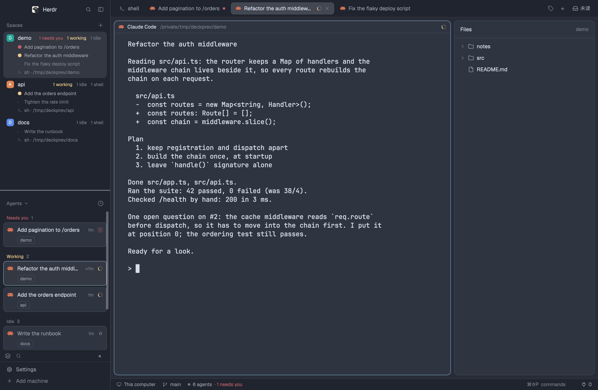

# Herdr layout: Agent Deck Plus

The [Agent Deck Plus](agent-deck-plus/) layout for [Herdr](https://herdr.dev): spaces
and agents on the left, Files / Changes / 未读 on the right, and one reading tab where
Cmd-clicked files land.

`agent-deck-plus/RECIPE.md` is the brief: another agent with an empty folder can build
it from there. The folder is laid out like `~/.config/herdr-app` (one layout, the mods
it needs, its theme, the `open` shim), so installing it is copying the files.

The layout and its eleven mods are a fork of
[zztalker/herdr-agent-deck](https://github.com/zztalker/herdr-agent-deck),
Apache-2.0 — see `LICENSE`; the recipe lists what this build changed. `agenttrail`
and `tourist` are this build's own, under the same license.
