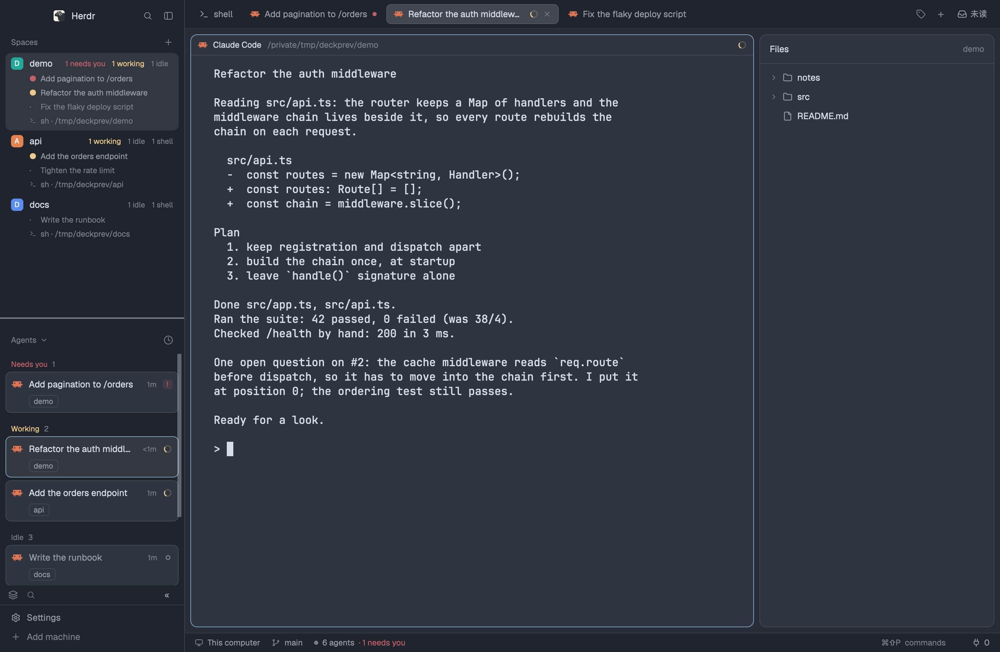

# Agent Deck Plus

A Herdr layout for people who run several coding agents at once: a sidebar that
says what every agent is doing, a tab bar that turns the right side into Files /
Changes / 未读, and a reading pane where a Cmd-clicked file lands.



Everything here is a folder laid out like `~/.config/herdr-app`: one layout, the
mods it needs, the theme it names, and the one script the reading pane depends on.
`RECIPE.md` builds it from an empty folder.

## Install

```sh
herdr-app do layout.clone '{"name":"main","as":"agent-deck-plus"}'   # only if the name is taken
cp layouts/agent-deck-plus.json  ~/.config/herdr-app/layouts/
cp layouts/agent-deck-plus.png   ~/.config/herdr-app/layouts/
cp -R mods/*                    ~/.config/herdr-app/mods/            # each folder, never into an existing name
cp themes/nord-default.json     ~/.config/herdr-app/themes/          # only if you don't have it
cp bin/open                     ~/.local/bin/open && chmod +x ~/.local/bin/open
herdr-app check ~/.config/herdr-app/mods/agent-deck-agents           # and each other mod
herdr-app do layout.switch '{"name":"agent-deck-plus"}'
```

`keys.json` here holds only the mod's own keys (`mod:preview-plus`); merge that
section into yours rather than replacing the file.

Needs Herdr.app 0.1.18 or newer with herdr-core, `herdr-app` on `PATH`, and the
Python 3 in `/usr/bin` for `bin/open`. Optional: `mmdc` (Mermaid diagrams),
`prism-link` (the 已关联 chip — set `setShared("prism.feishu", "https://project.feishu.cn/<space>")`
if your labels carry a bare `req`), `guided-review` (the 评审 chip), and
[tourist](https://github.com/BanTanger/herdr-mods/tree/main/tourist) (the 导览 rows in 未读).

## What it assumes

- macOS. The mods read `window().platform` and draw the traffic-light padding;
  other systems work but the `Cmd` keys become `Ctrl`.
- A font that has the icons: the author uses `JetBrainsMono Nerd Font Mono` at 16.
- `~/.local/bin` on the app's `PATH`, so Herdr's `open` is the shim here.

## Credits

A fork of [zztalker/herdr-agent-deck](https://github.com/zztalker/herdr-agent-deck)
(Apache-2.0, see `LICENSE`): the sidebar, Overview and History come from there.
This build adds the 未读 panel, `files-plus`, the reading pane and the live-ports
badge, the prism/评审 chips, and drops its harness board. `RECIPE.md` lists the
differences.
