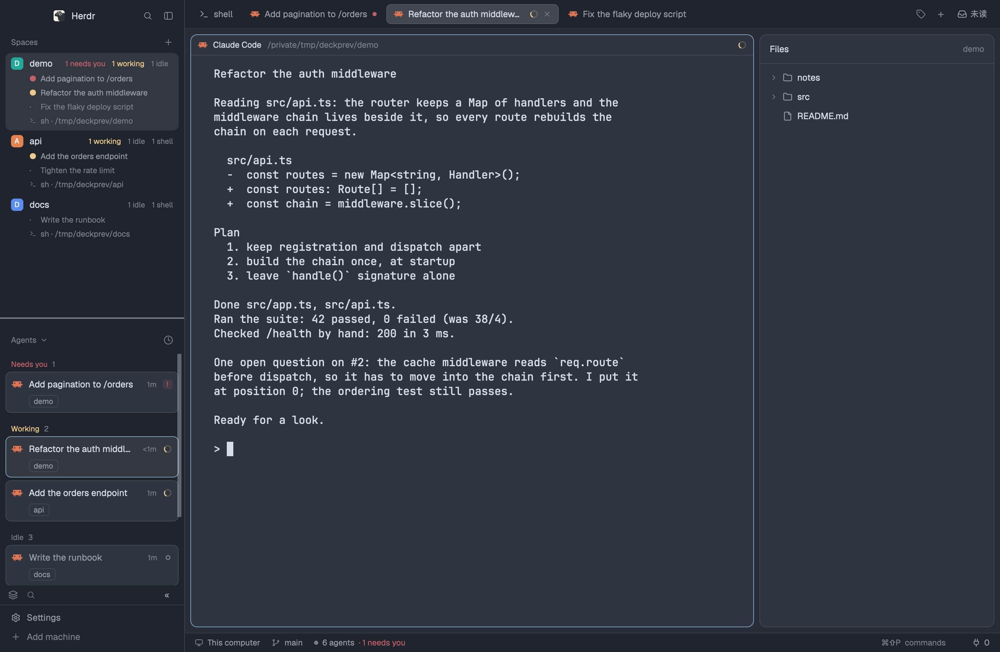

# Agent Deck Plus

A Herdr window for someone who runs several coding agents at once. The left column
lists every space and every agent on every machine, with what each is doing; the
tabs carry a Files / Changes / 未读 switch on the right, and a file clicked anywhere
(Cmd-click a link, a row in Files, a row in 未读) opens in one reading tab beside the
work. Nothing here is a web view: it is one layout JSON, nine Herdr mods, three of
Herdr's own, a theme file and one Python shim.



The screenshot is a demo instance: three invented spaces (`demo`, `api`, `docs`) and
six stand-in agents. No real session is shown.

## What you see

Window: `titlebar: "none"` (the layout draws its own bars), traffic lights at
`[12, 16]`, background `canvas`, terminal padding `14 × 12`. Theme dark
`nord-default` (background `#2e3440`, foreground `#d8dee9`), light `paper`. Type:
the app font (`JetBrainsMono Nerd Font Mono` at 16 in the author's `settings.json`);
every mod size below is a point value at zoom 1.0.

**Sidebar, 268 px (min 44, max 480), `chrome` background, not resizable by drag:**

- **Brand bar, 46 px**, the shipped `workspace-chrome`: the Herdr mark and name,
  a search button (`picker`), a sidebar toggle. Dragging it moves the window.
- **Spaces, half the remaining height (min 90 px)**, `agent-deck-spaces`:
  a 31 px header — "Spaces" 11.5 px `dim` on the left, a 26×26 `+` on the right
  (`space.new`); then the list, 13 px, 8 px side padding. Each space row is a
  30 px line (`28` for a worktree child) with an 18×18 rounded-5 avatar in the
  space's colour and its first letter, the name (max 150 px), a git tail
  (`repo · branch`, `↑n ↓n`, both suppressed when unremarkable), status counts in
  status colours (`1 needs you`, `1 working`, `2 idle`) and `N shells · M busy`.
  Under the row, up to 4 lines at 11.5 px: its agents' names with a status dot, then
  its shells/programs with a program icon and folder (or the program's own title
  while busy). Active space: `selected` background; hover: `hover`. Right-click opens
  Herdr's space menu; dragging reorders within the machine. Machines appear as 26 px
  headers (server/monitor icon, name, `needs you` pill, `N terms · M hidden`, `+`,
  a 6 px connection dot, a fold chevron) only when more than this computer is known.
- **Agents, the other half (min 90 px)**, `agent-deck-agents`: a 41 px header
  "Agents ⌄" that folds Spaces up (`layout.toggle {id:"spaces"}`) and, on the right, a
  14 px sort icon that opens the sort popup (Priority / Grouped by space).
  Agents are cards: 8 px radius, `surface` background, 1 px border, 2 lines,
  focused → `selected` background + `accent` border. Line 1: program icon, chat name
  (semibold, truncated), a fold chevron with the sub-agent count, time in state
  (`<1m`, `3m`, `2h`), and the status mark — a 12 px `working` spinner at 900 ms,
  an 18 px `Needs you` pill (`blocked` at 15 % alpha), a 7 px `done` dot, or a 7 px
  hollow `idle` ring. Line 2: the space chip, then a prism chip (`已关联` in `#fa8a0b`
  on dark / `#c2410c` on light when the terminal carries a `req` label, otherwise a
  `未关联` prompt), then a 评审 chip while a `herdr.review` label says
  `generating` (`预评审`, `working` tone) or `ready` (`待评审`, `ansi2` tone). Cards
  group under 30 px headers — `Needs you / Done / Working / Waiting / Idle` in
  priority sort, the space name in grouped sort — each with a count.
- **Agents footer, 28 px**: a layers button (Overview), a search button (History),
  and `«` on the right that narrows the sidebar to a **rail**.
- **Sidebar footer, 69 px**, the shipped `workspace-chrome` footer: Settings (with an
  `accent` dot when an update is ready) and Add machine.

**Rail (sidebar narrower than 160 px)**: spaces become 22 px coloured marks 34 px
apart with a 9 px status dot on the corner when one needs you; agents become 16 px
program icons with their status mark, or the task/role badge when labelled, and a
250 ms hover card showing the full card. The footer stacks Overview, History and `»`.

**Work column:**

- **Tab bar, 42 px**, `agent-deck-tabs` on `chrome`: pills 29 px high, radius 7,
  12.8 px text cut at 170 px; the active one `raised` with a `border` outline, the
  others transparent. A pill carries the program icon, the name, `Z` when zoomed, a
  spinner while working, a 6 px `blocked`/`done` dot, and a 12 px close glyph when
  active. Then: a 26 px tag button (label editor), `+` (new-tab menu), the panel
  buttons `Files`, `Changes`, `未读` (each 26 px, 12 px text, `selected` pill when
  that panel is showing). Drag the empty part of the bar to move the window.
- **Panes**: a rounded-10 card, 1 px `border`, `background` fill, `accent` 1 px
  focus ring; the 30 px pane header is always visible (`agent-deck-pane`) and shows
  program icon, name (max 260 px), folder (`~` shortened), the terminal's own label
  chips (10.5 px, max 480 px total, each 220 px, `key` dim + value), then the status
  (spinner / `Needs you` pill / `done` dot), and on hover four 14 px buttons: split
  right, split down, zoom, close.
- **Right panel, 342 px (min 280, max 900)**, a stack of `files-plus`, `changes` and
  `unread`, shown by the tab bar's buttons and remembered per space. It ships open on
  Files; the author's own window sits at 309 px on 未读.
- **Status bar, 28 px**: `workspace-status` (machine, branch, `N agents · 1 needs you`,
  and the chord bound to `app.palette` — `⌘⇧P commands`, or just `commands` when your
  keys bind none) and, in the last 64 px, `live-ports`: a plug icon and a count,
  `chrome` background, opening a 380 px popup.

## How it behaves

**Statuses** (an agent's own OSC 7501 report):
- `working` — a `working`-coloured spinner, 900 ms a turn.
- `blocked` — red: a `Needs you` pill on the card and the pane header, `!` in a
  compact card, a red border on the Overview card, a red count in the space row.
- `done` — a `done` dot; it stays `done` until you look at the tab.
- `idle` — a hollow `idle` ring and a dimmed name.
- `waiting` — an idle agent whose terminal has a `bg` report of `working`: a slow
  2400 ms spinner. Nothing in this build produces that record (no `hc report`), so
  the Waiting section and pill stay empty.

**Clicks:**
- agent card → `pane.focus {pane}`; a folded chevron → the sub-agent tree; a
  sub-agent row → `terminal.peek {terminal}`; the link glyph on a Claude Code card →
  a `herdr-resume://` link on the clipboard; the pin glyph → pin to the top.
- prism chip → opens the requirement in Feishu (`exec open`), ⌘-click → the bind
  dialog; the `未关联` chip → the same dialog, and a horizontal swipe of 28 px
  (48 px on a trackpad) dismisses it for that session.
- 评审 chip → selects the review's Guide tab, or makes one (`tab.new` with
  `mod: "guided-review"`, name `评审·<chat>`).
- space row → `space.select`; its `+` → `space.new`; machine header → fold.
- tab pill → `tab.select`; drag a pill onto another → `tab.move {id, index}`
  (drop after the pill you released on); double-click → `tab.rename`; right-click →
  Herdr's `menu` popup; wheel → previous/next tab; a close glyph → `tab.close`.
- tag button → the label editor for the focused terminal.
- `Files` / `Changes` / `未读` → show that stack child and `layout.show {id:"panel"}`;
  pressing the showing one → `layout.hide {id:"panel"}`. The choice is remembered per
  space in the mod's localStorage.
- `+` → `new-menu` (start an agent, new space, worktree).
- pane header buttons → `pane.split {direction}`, `pane.zoom {pane}`,
  `pane.close {pane}`.
- Files: a folder row expands in place; a file row writes `request.json`, reuses the
  preview tab if it still exists, else runs `herdr-app do tab.new` for
  `preview-plus` and selects it. `←` goes back to the tree.
- 未读: a row runs the shim (`~/.local/bin/open <file>`) and the preview tab follows;
  全部已读 writes every queued file as read into `progress.json`; 导览 rows select the
  tab they came from.
- Files / Changes / 未读 rows show git marks (`A` `ansi2`, `M` `blocked`,
  `D`/`U` `ansi1`) and reading progress (a 2 px `ansi4` bar) respectively.
- live-ports: the button opens the popup; a group header selects its space; a port
  row opens `http://localhost:<port>` or stops it (`kill <pid>`); `Other processes`
  folds out ports with no worktree root.

**Keys** (from `keys.json`; the ones this bundle ships are in `keys.json` here):
- `⌘⇧O` Overview, `⌘⇧M` Agenttrail, `⌘⇧G` Tourist, `⇧⌘Y` Customize — the last
  three are not part of this layout; drop those lines if you don't install those
  mods.
- `⌘B` folds the sidebar to the rail (`layout.toggle:sidebar`).
- In the preview tab: `⌘⇧↑/↓` font, `⌘⇧/` source, `⌘S` save, `⌘⇧↵` open folder,
  `⌘F` find, `⌘⇧[`/`]` previous/next queued file.
- In the Overview: typing filters, `Esc` closes the task menu, then clears the
  filter, then the dialog.

**Moves:** the two halves of the sidebar share their height with a 2 px `dim`
divider you can drag; the right panel's width is draggable; the whole sidebar is not.

## Built from

Files, laid out like `~/.config/herdr-app`:

```
layouts/agent-deck-plus.json      the layout
layouts/agent-deck-plus.png       the picture its settings row shows
mods/agent-deck-agents/           main.js + badge, chip, prism-bind(-view), prism-prompt-view,
                                  prism-toast, review, review-chip, resume, title (+ 6 .test.mjs)
mods/agent-deck-spaces/           main.js
mods/agent-deck-tabs/             main.js + name.js (+ test), win-{min,max,restore,close}.svg
mods/agent-deck-pane/             main.js + labels.js (+ test), close/split-right/split-down/zoom/unzoom.svg
mods/agent-deck-labels/           main.js + edit.js + colors.js (+ test), tag.svg
mods/agent-deck-overview/         main.js + labels.js + usage.js + resume.js (+ tests), link.svg
mods/agent-deck-history/          main.js + history.js (+ test)
mods/files-plus/                  main.js + 4 svg (a clone of the shipped `files`, 0.1.13)
mods/unread/                      main.js + queue.js + tests/ + package.json, inbox.svg
mods/preview-plus/                main.js + progress.js + resize.js
mods/live-ports/                  main.js + scan.js + plug/folder/external/stop.svg
themes/nord-default.json          the dark palette
bin/open                          the Python 3 shim (installs to ~/.local/bin/open)
keys.json                         only the mod's own keys
```

The mod folders do **not** carry `gpui-kit.d.ts` or `jsconfig.json`: Herdr rewrites
those into each mod on every start, so a build must not ship them.

**Layout tree** (ids matter — mods and keys address nodes by id):

```
root  row           canvas, divider 1 border, titlebar none, traffic_lights [12,16]
├─ sidebar  column  px 268, min 44, max 480, background chrome, resizable false
│  ├─ brand           block  workspace-chrome                    px 46,  window_drag
│  ├─ sidebar-lists   column gap 12, divider {2, dim}
│  │  ├─ spaces        block  agent-deck-spaces      weight 1, min 90
│  │  └─ agents         block  agent-deck-agents      weight 1, min 90
│  └─ sidebar-footer   block  workspace-chrome {footer:true}     px 69
└─ work  column      resizable false
   ├─ tabs            block  agent-deck-tabs          px 42,  window_drag
   ├─ work-body  row  padding 8, gap 8
   │  ├─ main         block  {tab:"active", pane:{ header:{content:{mod:"agent-deck-pane"},
   │  │                       height:30, reveal:"always", position:"top"},
   │  │                       radius 10, gap 8, background "background",
   │  │                       border {1, border}, focus {1, accent}, lone:true }}
   │  └─ panel  column px 342, min 280, max 900   (ships visible on `files`)
   │     └─ panel-body  stack  files → files-plus | changes → changes | unread → unread
   └─ node-1  row     px 28, resizable false
      ├─ status       block  workspace-status   weight 1
      └─ live-ports    block  live-ports         px 64
```

Root also carries `theme {light:"paper", dark:"nord-default"}`, `terminal_padding
[14,12]`, `preview: "layouts/agent-deck-plus.png"`.

**Mods and what each is for:** `agent-deck-spaces` (space list, machine headers,
space colours in `shared("space.colors")`, git state by `exec("git", …)`), 
`agent-deck-agents` (cards, sort, pins, labels badges, prism and 评审 chips, the rail),
`agent-deck-tabs` (pills and the panel switch, one panel choice per space),
`agent-deck-pane` (header + label chips), `agent-deck-labels` (dialog; saves with
`hc label <address> k=v …`), `agent-deck-overview` (⌘⇧O board, lanes per status and
per machine, `Usage` via `/proc`/`top`/`vm_stat`/`df`), `agent-deck-history` (past
sessions), `files-plus` (tree + inline text), `unread` (the preview queue), 
`preview-plus` (the reading tab: markdown, source toggle, find, save, Mermaid via
`mmdc`), `live-ports` (`lsof`/`ss` per machine, published to `shared("live-ports")`).

**Shipped mods it uses:** `workspace-chrome` (brand + footer), `workspace-status`
(status strip), and the panel/mod assets it points into: `files`
(`mods/files/file.svg`), `changes` (`changes.svg`, and the Changes panel itself),
`pane` (`mods/pane/close.svg`), `unread`'s own `inbox.svg`, also `menu`, `new-menu`,
`machine-add`, `picker`, `worktree` — all opened by these mods.

**App calls it makes** (`herdr` module): `spaces`, `panes`, `terminals`, `agents`,
`machines`, `layout`, `window`, `theme`, `settings`, `shared`/`setShared`, `props`,
`run`, `openOverlay`/`closeOverlay`, `notify`, `exec`, `hc`, `readTextFile`,
`writeTextFile`, `watchFolder`, `home`, `appHome`, `setAgentOrder`,
`cx.write_to_clipboard`, `cx.timer.every`, `HoverCard`, `Popup`, `Input`, `Editor`,
`TextView`. Commands: `tab.new/select/close/rename/move/next/prev`, `space.*`,
`pane.focus/split/zoom/close`, `agent.focus/next/prev`, `layout.show/hide/select/
resize/toggle`, `mod.open`, `terminal.peek`, `window.minimize/maximize/close`,
`app.settings/palette`.

**Programs and paths it runs:** `sh -c` (folder listing), `git` (`status`,
`rev-parse`), `hc` (`machine ls`, `label`, `get`, `exec`, `read`), `herdr-app do
tab.new|tab.select`, `open` (a file, a folder, a Feishu URL), `kill <pid>`, `lsof`
(fallback `ss`), `top`/`vm_stat`/`sysctl`/`df`, `mmdc` (optional), and
`~/.local/bin/prism-link` (`mine`, `link`) for the prism chips. Files it reads and
writes outside its own folders: `~/.cache/herdr-open/{request.json,queue.json,tab}`,
`~/.cache/preview-plus/progress.json`, `~/.local/state/prism-link/events/*.json`,
`~/.claude/sessions/*.json` (Copy link), `$HERDR_APP_HOME/data/tourist/tours.json`
(导览 rows), `cache/preview-plus/mermaid/` (diagram pictures), and mod-local
`data/<mod>/` storage files.

**Art:** inline SVG only — chevrons, the spinner, the tag, the link, the plug, the
window glyphs; tints are theme tokens (`dim`, `muted`, `foreground`, `accent`,
`working`, `blocked`, `done`). The Herdr mark is `frame/welcome/herdr.png`
(written by the app, not shipped here).

## Watch out

- **This is a fork**, of `zztalker/herdr-agent-deck` (Apache-2.0). The sidebar,
  Overview and History are upstream code; the prism and 评审 chips, the 未读 panel,
  `files-plus`, the reading pane and the live-ports badge are this build's. Two
  upstream files are **older** here than upstream: `agent-deck-overview/labels.js`
  and `agent-deck-labels/{main,edit}.js` lack the `h.*` "hidden tags" filter, so a
  harness that labels terminals `h.state`/`h.next` will see those chips on cards and
  rows in the editor. Keep them or port the filter, but decide deliberately.
- **The shim is load-bearing.** `~/.local/bin/open` is a 4.6 KB Python 3 script: when
  its parent process is the Herdr binary it writes `request.json`, appends to
  `queue.json` (≤ 40 entries), reuses or creates the `preview-plus` tab through
  `herdr-app do`; every other caller is exec'd to `/usr/bin/open`. Herdr resolves it
  through the app's `PATH`: a Finder-launched app may not see `~/.local/bin`, and then
  Cmd-click goes to Finder and the 未读 panel stays empty forever. Launch Herdr from a
  shell, or point the app at the shim some other way.
- **Two app CLIs are assumed**: `~/.local/bin/herdr-app` (the shim and `files-plus`
  call it by absolute path) and `hc` on `PATH`.
- **`prism-link` and Feishu.** Without `~/.local/bin/prism-link` the prism chips show
  `未关联` and the bind dialog fails on `exec("env", …)`. Without a `req` label nothing
  is shown at all. A `req` label that carries no `req_url` opens the base kept in
  shared state — `setShared("prism.feishu", "https://project.feishu.cn/<space>")` — or,
  unset, the base of any live `req_url` on another terminal; with neither, the chip
  opens no URL and shows a warning toast saying which key to set. Drop the prism code
  if you don't use Feishu.
- **`guided-review` is not in this bundle.** A 评审 chip only exists when a terminal
  carries `herdr.review`, and clicking it opens a tab of `mods/guided-review`, which
  you must install separately (or the tab opens empty).
- **`tourist` is optional**: its `tours.json` populates the 导览 group in 未读; without
  it the panel starts at the file list. It lives at
  [BanTanger/herdr-mods/tourist](https://github.com/BanTanger/herdr-mods/tree/main/tourist).
- **`mmdc` is optional**: without it a Mermaid fence stays the code it is, in a
  bordered box that says what to install.
- **Theme tokens are derived.** `themes/nord-default.json` only sets
  `background/foreground/selection/ansi*` and six `colors` values; `chrome`, `surface`,
  `raised`, `hover`, `selected`, `border`, `accent`, `popover`, `working`, `blocked`,
  `done`, `idle` are computed by the app from that file. Never hardcode their hex.
- **The pane header always draws its divider on the bottom** (`border_b`), because the
  fork dropped Herdr's `header.position === "bottom"` branch. A layout that puts the
  header at the bottom will draw the wrong edge.
- **The tab bar lost its auto-scroll and its touchpad wheel accumulator** in the fork:
  it moves one tab per wheel event with no idle reset, and the active pill can sit
  off-screen in a long strip.
- **Sizes are limits a fresh build can trip over**: pill text 170 px, pane name
  260 px, chip containers 220/480 px, Files 500 entries per folder and 5 000 total,
  previews 400 000 chars, the queue 40 entries, the Overview's empty lane 150 px and
  its cards 240/260 px minimum, port rows fixed at 54 px so the popup can be placed
  above the button.
- **`⌘⇧↵` is bound twice**: `pane.zoom` globally and `preview-plus.folder` in
  `mod:preview-plus`; while the preview pane has focus the mod wins. `⌘⇧O`, `⌘⇧M`,
  `⌘⇧G`, `⇧⌘Y` in the author's `global` section point at mods this bundle does not
  ship.
- **`herdr-app check` passes on all eleven mods but prints scheduler warnings**
  ("a reload stranded script tasks…") — they come from `init()` registering timers,
  which is the documented pattern; they are not errors.

## Done when

Run these against a real Herdr; each one is something this build does.

1. `herdr-app check ~/.config/herdr-app/mods/<name>` prints `check passed` for all
   eleven mods (`agent-deck-agents`, `-spaces`, `-tabs`, `-pane`, `-labels`,
   `-overview`, `-history`, `files-plus`, `unread`, `preview-plus`, `live-ports`).
2. `herdr-app do layout.switch '{"name":"agent-deck-plus"}'`: three columns appear —
   268 px sidebar (`chrome`), work area with a 42 px tab bar, 342 px right panel open
   on Files, 28 px status strip — and the sidebar's two halves split at the drag
   divider.
3. In a terminal that reports OSC 7501 (`hc run -- claude`), the agent appears as a
   card within a second, its space row gains `1 working`/`1 needs you`, and the card
   turns into a spinner while it works and a `Needs you` pill when it asks.
4. `⌘B`: the sidebar collapses to the rail (76 px on macOS), space marks and program
   icons, and the footer's `»` brings back 268 px.
5. Click a `.md` file in the Files panel: a `Preview` tab opens with the rendered
   text, the tab bar shows it as the active pill, and the file appears — read — in the
   未读 list with its progress bar.
6. Cmd-click a `file:line` link in a terminal: the same preview tab shows it, and
   `~/.cache/herdr-open/queue.json` gained that path.
7. Right-click a tab pill: Herdr's menu popup opens at it (Rename / New tab / Close);
   drag one pill onto another and the order changes; wheel over the bar switches tabs.
8. Press `+`, start a second agent: a second tab and a second card, the two grouped
   under the right heading, and `⌘]` moves the selection in the same order as the list.
9. Merge `keys.json` into yours and press `⌘⇧O`: the Overview opens at 85 % × 85 %,
   lanes populated, `Terminals` tab lists every machine with its terminals.
10. Start a listener (`python3 -m http.server 8123`) in a space: within 4 s the
    status bar shows a plug and a count, and the popup lists the port under that
    space, with `Open in browser` and a stop button.
