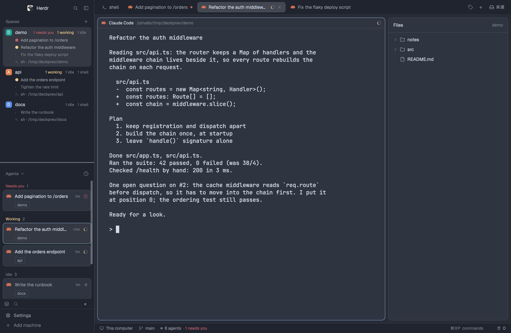

# Agenttrail

A dependency board of one repo's tickets. Every ticket in a `.wayfinder` map or a
`.scratch` to-tickets slate becomes a card, cards sit in columns by what still
blocks them, and arrows run from blocker to blocked. Clicking a card lights its
whole connected chain and starts a route you can walk with the arrow keys or by
clicking a line; double-clicking a card opens the ticket file in a `preview-plus`
window. It is read-only apart from deleting a slate.



## What you see

A **floating window** (`mod.json`: `{"place":"none","title":"Agenttrail",
"overlay":{"kind":"window","key":"agenttrail.board"},"focusable":true}`), opened
with `cmd-shift-m`, and it can be handed over to a tab.

**Header**, 64 px tall (44 px under 560 px width): two macOS dots on the left
(12 px, `#ff5f57` closes, `#28c840` grows to 1.25× and back), the app mark
(`mark-dark.svg`/`mark-light.svg`, 28 px), the map title at 14 px semibold in
`foreground`, a 12 px `muted` subtitle of the repo path (`~/…`) and
`→ <current ticket>`, then a 24 px stage chip — a 6 px dot plus `进行中 · 3/7`
(`待开工`, `已完成`, `建图中`, `空`; the dot pulses while work is in flight) — and,
when a slate is open, 28 px reveal and delete buttons on the right.

Two optional strips sit under it at 30 px: an "away" strip when the focused
terminal is in another repo (`… 没有票 · 正在显示 …` with a `浏览…` link) and a
slate strip of 20 px chips when the repo holds more than one slate.

**Canvas** — `canvas` background with a 24 px dot grid that pans with the world and
never scales; cursor `grab`/`grabbing`. Cards are 400 × 128 world units, radius 12,
`surface`, 1 px `border` (`accent` when open/live/current/on the lit chain,
`blocked` when blocked, 2.5 px when clicked), and when opened they grow by a
detail panel that hangs 24 px below on a small connector.

A card carries: a 3 px type stripe in the kind's colour; a 20 px kind chip
(讨论/调研/原型/任务/票 in `ansi3/ansi4/ansi5/ansi6/muted`); `#01` in mono; a status
glyph at the top right (18 px: a `done` disc with a check, a 1100 ms `accent` arc
while active, a `blocked` disc with `!`, a `dim` ring while pending); the title at
15 px semibold, cut at 28 chars; a second line (`被 01、02 阻塞` in `blocked`, else
`3/5 项验收 · 进行中`); a 4 px checklist track filled in `accent` or `foreground`;
`展开 ▾` at the bottom left; `已定` / `当前` / `下一步` on the right when they apply;
two 8 px port circles at the middle of each end. A card whose file changed in the
last 60 s also shows a spinning `arc-live.svg` and `编辑中`.

**Edges** are one cubic Bézier per `blockedby` link, 1.5 px `border` — dashed and
`accent` when either end is on the taken route — with a filled triangle head.
The taken route is a 3 px `#a78bfa` line; a pending candidate is dashed `#c4b5fd`.

**Toolbar** (top-left of the canvas): `−`, the zoom percentage, `+`, then `fit`,
a `live` button when something is live, `↶` and `↺` while a route exists, `◎`, and
a `n/m` chip while an edge is a candidate. **Legend** (bottom-left): one 10.5 px
entry per kind with its count.

Empty states: no focused terminal, a repo with no slates (`… 里没有票` plus a
`选择文件夹…` button), a map with no tickets yet, and `读取中…`.

## How it behaves

**States** come from the ticket file: done when its status says closed/done/
complete/resolved/merged/wontfix/cancel or every checklist item is ticked; blocked
when any prerequisite is not done; active when claimed (`claim|working|progress|
active|doing|started` in the status, or front-matter `claimed` with an `assigned`
that is not `unassigned`); pending otherwise. `live`/`编辑中` is a separate flag:
the file's mtime is under 60 s old.

**Clicking a card** lights its undirected connected component (everything off it
drops to 0.28 opacity, the chain's edges thicken to 2 px `accent` with dashes
flowing ~25 px/s) and toggles its detail panel; the click also starts a route at
that card. **Double-click** opens the ticket file in a `preview-plus` window keyed
`agenttrail.preview.<path>`; other preview windows are re-opened first so they keep
their place.

**Walking the route:** `↑`/`↓` step the arrow candidate through the lines touching
the route's tip (leaving lines first, then arriving ones, by position), `→` takes
the candidate and `←` gives the last hop back, `↶` pops the last hop, `↺` clears
everything, `◎` centres the tip (fitting it below 0.6 zoom), `Esc` clears the light
or closes the window. Clicking a line on the canvas within 8 screen px takes that
edge; a click on empty canvas with nothing near clears the light.

**Canvas:** drag pans (under 4 px counts as a click), the wheel pans only, and a
trackpad pinch zooms around the pointer. Zoom stays between 0.1 and 3; `−`/`+` are
0.85/1.18 around the centre, the percentage resets to 1, `fit` frames every card
with a 96 px margin, and `◎` never changes the zoom.

**Header:** press it to drag the window; the green dot grows to 1.25× and restores.
Only the right edge, the bottom edge and the bottom-right corner resize (6/6/16 px
hit areas); the size is written to `shared("agenttrail.window")` and remembered.
The delete button opens a 540 × 236 confirmation; the deletion is refused unless
the path is exactly one directory under `.wayfinder/maps/` or `.scratch/`. The
folder button reveals the slate in the platform opener.

**Keys** (`keys.json`): `cmd-shift-m` opens the window, `cmd-shift-up`/`cmd-shift-down`
send `zoom-in`/`zoom-out`. `fit`, `live`, `expand` and `collapse` are implemented as
mod commands but nothing is bound to them.

**Data:** `.wayfinder/maps/<slug>/{map.md,tickets/*.md}` or
`.scratch/<slug>/{map.md,issues/*.md}`, found for the focused terminal's repo (then
the folder itself, the last slate folder, and the remembered home). Front matter is
flat `key: value` (`title`, `status`, `type`, `blockedby`, `blocks`, `claimed`,
`assigned`); without it the parser reads `**Status:**`-style lines and the `# `
heading, and derives the id from a 1–3 digit filename prefix. Checklists are
`- [ ]`/`- [x]`; without one, up to 12 bullets or prose lines from `## Question`
become note rows. `## Decisions so far` in the map gives a ticket its `已定` gist.

**Polling:** one loop per copy wakes on `watchFolder` of `.scratch`/`.wayfinder`,
on a 5 s timer, or on a focus/slate change; it re-scans only when the derived board
changed, so a ticket written by an agent appears at once.

## Built from

```
main.js     the View (default export): header, canvas, toolbar, route, keys, polling
trail.js    markdown → board: splitFront, parseTicket, parseMap, buildBoard, stageWord
graph.js    pure geometry: boardLayout, boardEdges, chainOf, waysFrom, edgeNear,
            liveCard, openingCard, hostOf, statusLabel
resize.js   the edge/corner resize handles (the same file ships in preview-plus)
mod.json    {"place":"none","title":"Agenttrail",
             "overlay":{"kind":"window","key":"agenttrail.board"},"focusable":true}
*.svg       check, arc-status, arc-live, fit, live, folder, trash, mark-dark, mark-light
```

`trail.js` imports nothing from `herdr` — `exec`/`readTextFile` are injected — so it
runs under plain node; `graph.js` is pure arithmetic. Text is positioned by hand
(`top = (y − size·0.975) × zoom`), because the runtime has no group transform;
`fill`/stroke widths are multiplied by the zoom by hand too.

**App surface:** `View, div, svg, image, PathBuilder`; `h_flex, v_flex`; `spaces,
panes, focused, layout, settings, shared, setShared, props, theme, window as
appWindow, run, exec, readTextFile, notify, openOverlay, closeOverlay, pickFolder,
watchFolder, nextCommand`; `cx.focus_handle, cx.timer, cx.spawn, cx.sleep,
cx.notify, cx.stop_propagation`. Commands: `tab.new, tab.select, tab.close,
pane.zoom`, and the mod's own `zoom-in, zoom-out, fit, live, expand, collapse`.

**Programs it runs:** `git rev-parse --show-toplevel` (cached per folder),
`find <dir> -maxdepth 3 -type f -name "*.md" -exec stat -f "%m %N" {} +`,
`rm -rf -- <slate>`, and `open`/`explorer`/`xdg-open <dir>`.

**Theme tokens only:** `canvas, surface, hover, selected, raised, popover, border,
foreground, muted, dim, accent, accent_foreground, blocked, done, background,
ansi3..6`. Two fixed colours: the taken route `#a78bfa` and the candidate `#c4b5fd`.

**Shared state it writes:** `agenttrail.folder`, `agenttrail.home`,
`agenttrail.view` (`{zoom, x, y, auto, open, closed, selected, route, to, seq}` —
the camera and the folded cards, so a tab copy continues where the window was) and
`agenttrail.window` (`{w,h}`). It reads `preview-plus.open` for its preview windows.
Overlay names: `agenttrail.board`, `agenttrail.preview.<path>`.

## Watch out

- **`preview-plus` is the double-click target.** Without it the window opens onto
  nothing and only the bookkeeping runs. It is also where `resize.js` comes from —
  keep the two copies in step.
- **`stat -f "%m %N"` is BSD.** On Linux the first scan fails and the mod silently
  falls back to a listing without mtimes: no card is ever `编辑中`, the `live`
  button loses its target, and slates sort in scan order.
- **The scan is depth-limited** (`-maxdepth 3`): a slate must be exactly one
  directory below `.wayfinder/maps` or `.scratch`, and a nested `research/` file
  counts in the file total but never becomes a ticket.
- **Deleting is the only write**, and it trusts the dialog's props. The safety net
  is the path guard (one directory under `.wayfinder/maps`/`.scratch`); keep it.
- **Nothing is bound to `fit`/`live`/`expand`/`collapse`.** The "hand over to a
  tab" path exists but no control or key reaches it; bind it in `mod:agenttrail` if
  you want it, and say so rather than inventing a button.
- **Render must stay under 50 ms** or Herdr drops the frame: the mod stops drawing
  detail rows past 28 ms and whole cards after that, and caches edges (keyed on
  zoom, palette, chain, hops) and the grid. A rebuild should keep both the guard and
  the caches, or every pan rebuilds every path.
- **Dashes are recomputed per frame** while a chain is lit (GPUI has no dash
  offset), so the lit state is the only thing that costs frames when idle.
- **`Geist` / `Geist Mono` are hard-coded.** Herdr ships them; a machine without
  them renders the fallback and the card metrics still hold, but check `fonts()` if
  it looks wrong.
- **Limits to keep:** 400 tickets per slate, cards 400 × 128 (opening adds
  24 px plus 45 px per row), zoom 0.1–3, window 360 × 300 minimum and
  2600 × 1800 maximum, also clamped to the viewport minus 24 px.
- **Two copies fight over `agenttrail.folder`** by design (it answers "where am I"
  for the other copy); `agenttrail.home` is the tie-breaker that keeps a `/tmp`
  terminal showing the last real slate.

## Done when

1. `herdr-app check <mods>/agenttrail` passes and `node --check graph.js trail.js
   resize.js` is clean.
2. With a fixture repo holding `.scratch/demo/map.md` and `issues/01-…md`
   (`blockedby: []`), `02-…md` (`blockedby: [01]`), `03-…md` (`blockedby: [01]`,
   one checked and one unchecked item): `cmd-shift-m` opens the window; 01 sits in
   the first column, 02 and 03 in the second, arrows run left to right; the header
   reads the map title, the repo path and the chip `待开工 · 0/3`; the legend lists
   the kinds.
3. Click 02: its detail panel opens with the checklist, the 01–02–03 chain stays
   bright while anything else drops to 0.28 opacity, its edges thicken and flow, and
   `↶`/`↺` appear.
4. `↓` then `→`: the tip moves to the neighbouring card, the violet route draws over
   the chain, the counter chip shows `n/m`, and the tip's card grows a violet bottom
   bar. `←` and `↶` retract the hop; `↺` clears everything; `Esc` with nothing lit
   closes the window.
5. Drag empty canvas: cards and dots move together and the dots never scale. Wheel
   pans. `+`/`−` and the percentage behave; `fit` frames every card; `◎` centres the
   tip without changing the zoom.
6. Shrink the window under 560 px: the header drops to 44 px, loses the subtitle and
   the reveal/delete buttons, and the toolbar inset falls to 8.
7. Double-click a card: a `preview-plus` window opens on that file; double-click
   another: the first stays where it was. Drag the bottom-right corner: a `W × H`
   hint follows. Reopen with `cmd-shift-m`: the window comes back at that size.
8. The delete button asks first; `Esc` leaves the slate alone, `删除` removes exactly
   that one directory and notifies; a folder that is not a slate is refused.
9. Write a ticket file while the board is open: the card appears within a poll (or
   at once through the folder watch), the counts change, and the card shows the
   spinning live arc and `编辑中` for 60 s.
