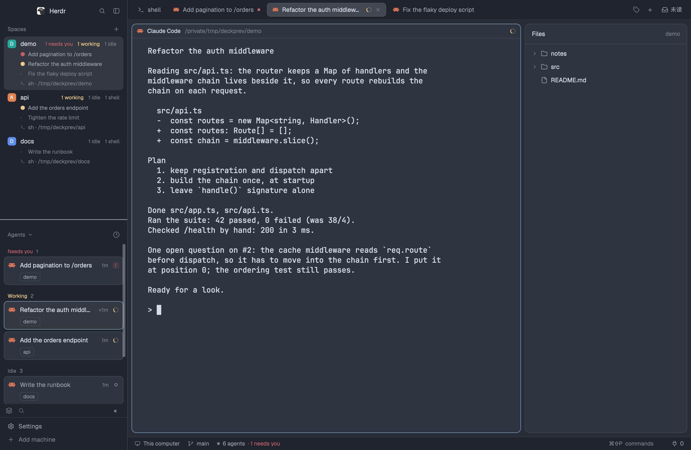

# Tourist

A guided read of one change. You say what to tour — this branch, the last commit, a
pull request, the whole repo, one feature, or one requirement across several
projects — and an agent plans 4–10 stops, each a file and a line range with a few
sentences of why it matters. Tourist then shows the stop: the diff on one side,
the explanation on the other, `j`/`k` to walk it. On a pull request the same pane
takes inline comments, posts the review, lists the checks, fixes the comments in a
worktree and merges; the tour is saved per tab, so closing and reopening the pane
comes back to the same stop.



## What you see

A **pane**, not an overlay: `mod.json` is `{"place":"none","focusable":true,
"title":"Tourist","overlay":{"kind":"popup","width":1,"height":1,"frame":"none"}}`.
The popup copy is a launcher — it splits `tourist` right of the focused pane (or
closes the existing one: the key is a toggle), closes itself, and optionally zooms
the new pane when `shared("tourist.full")` is on. There is no background of its
own; the pane's frame shows through.

Type comes from `settings().ui_font_size` (13 by default): body 14, section 16,
title 23 in the setup header; code 14 with 22 px rows. Padding 22 frame / 14 pane,
rows 38 (32 compact, 48 tall), radius 8.

**Setup screen** — title "Tourist" with a gear; the repo and branch under it in
`dim`; `导览者 <agent>` and, for omp, `· 模型 <name>` — both clickable. Then
`第 N 步，共 M 步 · <name>` and one row per choice: a 20 px letter badge (the key),
the name, and a dim line of detail (`相对 main 有 6 个文件`, `1a2e997 init`, …).
The highlighted row is `selected`; a feature name or a requirement filter gets a
text box under it. A legend of keys sits at the bottom.

**Planning** — a spinner and `通常 30 到 90 秒`; `q`/`esc` cancels the agent.

**Tour screen** — a header with `3 / 18`, the repo tag on requirement tours, the
stop title, tags (`自你在 <sha> 的评审后`, `分支已更新 · r 重新规划`,
`已保存的导览 · r 重新规划`), the plan title, a CI badge (`✗ 2 失败` in `ansi1`,
`● 1 运行中` in `ansi3`, `✓ 12 通过` in `ansi2`) and the gear.
Under it a clickable file line: path in `accent`, monospace, then
`行 40–58 · 点击某行添加评论，shift 点击扩展（已保存 2 条）· o 打开 PR`.
Then two panels, side by side at ≥1100 px wide (draggable split at 70 %) and
stacked below that: the **code panel** (22 px rows, 43 px line-number gutter, 9 px
mark column, `+` rows washed `ansi2` at 10 %, `-` rows `ansi1`, hunk headers
`raised`, the current stop's numbers in `accent`, hairline separators reading
`站点 3 · title`) and the **explanation** (markdown, `path:line` references
clickable, banners for ticket state, failed checks, last review).
A bottom bar of key buttons: 上一站 / 下一站 / 更深入 / 更技术 / 提问 / 评审 /
请求修改 / 修复 / 检查 / 合并 / 并排 / 文件 / 新导览. On a PR a 225 px file rail
sits leftmost: files grouped into 导览内 (with `1.2` sub-rows), 其他改动 and
测试、文档与生成文件, each row with a viewed check, `+n`/`−n` and a comment count.

**Requirement browser** — a 360 px rail of projects and their branches
(`N 个工程 · M 个提交`), each with `N 个文件`, `+x`/`−y`; the right side shows the
selected commit's diff (600 rows at most); `g` tours the whole requirement across
projects.

**Dialog, settings, confirm** — the settings sheet is 340 px at top-right (options
and rebindable keys); confirmations are a 440 px card over a 70 % backdrop.

## How it behaves

**Scopes** (`b c p r f n`): 分支改动 (never saved as a plan), 最后一次提交,
拉取请求, 整个仓库, 某个功能, 某个需求. **Depth** (`1 2 3`): 概览 / 常规 / 深入 —
the prompt wording, not a filter. **Pass** (`s w`) for a re-review.

**Keys** (rebindable through the settings sheet; `,` opens it):
`j`/`↓` next, `k`/`↑` previous, `shift-j`/`shift-k` scroll the code 3 rows,
`d` deeper, `t` technical, `a` or `/` ask, `e` explain a file outside the tour,
`o` open (PR files page, else the file at the line), `s` split/stack, `b` files
rail, `v` viewed, `p` post review, `f` fix, `g` request changes (ticket tour),
`c` checks, `m` merge, `r` replan, `q` reset, `z` zoom the pane, `esc` back.

**On the tour:** a numbered line click opens a comment box; shift-click stretches
it to a range (cut at a hunk header); a saved bubble can be edited or deleted; on a
PR, GitHub threads can be replied to, resolved and unresolved. A link in the
explanation scrolls the code to that line. `p` posts `{commit_id, event, body,
comments}` through `gh api … /reviews` after a confirm (two presses); a successful
post marks the head reviewed. `m` merges with
`gh pr merge <n> --<method> --match-head-commit <head>` on your own PR, and on a
ticket tour also approves it. `f` creates `data/tourist/worktrees/…`, lets the
agent edit there, shows the diff per file, and `p` commits
`Address review comments on #<n>`, pushes, drops the worktree and re-points the
tour at the new head; `x` discards.

**Saving:** a plan is cached per scope+depth+head (and PR number, feature text,
requirement id) under `data/tourist/plans/`; branch tours are never cached. The
pane writes `data/tourist/tabs/<tabId>.json` (debounced 250 ms) and one row per tab
into `data/tourist/tours.json`, which the `unread` mod reads to list tours beside
unread files. Reopening the pane restores the stop; `q` clears it.

**While a review is open** (opened from another mod with a `ticket` prop) Tourist
polls the ticket every 10 s and the checks and threads every 30 s, refreshing the
tour when the head moved and you are not typing or commenting.

## Built from

```
main.js          the View, phases, key(), the polling loops
agent.js         AgentSession: prompt files, hc run, output parsing per agent
plan.js          the plan prompt and parsePlan (JSON between first { and last })
constants.js     SCOPES, DEPTHS, PASSES, SHORTCUTS, prompts
git.js           git plumbing: diffs per scope, merge-base, shortstat, worktrees
gh.mjs           the GitHub CLI bridge (also runs under plain node)
ticket.mjs, comments.js, review.js, merge.js, checks.js, since.js,
saved.js, pr.js, files.js, diff.js, highlight.js, code.js, links.js,
branches.mjs, requirement.js, worktree.js, tours.js, models.js,
omp-events.mjs, kit/ (theme, rows, shortcuts), views/ (setup, require,
planning/error, tour, checks, review, merge, fix, diff, confirm)
```

`mod.json`, `jsconfig.json`, and no build step: ES `import` between siblings, assets
read as `mods/tourist/<file>`. Theme tokens only (`foreground, muted, dim, surface,
raised, selected, hover, border, accent, popover, background, ansi1..6`).

**App surface used:** `View, div, Input, InputState, TextView, spinner,
h_resizable, v_resizable, Scrollbar, Slider`; `spaces, panes, focused, layout,
settings, theme, props, shared, setShared, window, home, appHome, run, exec, hc,
notify, closeOverlay, nextCommand, readTextFile, writeTextFile, watchFolder,
checking`. Commands: `pane.split, pane.close, pane.zoom, tab.close, tab.select`.

**Programs it runs:** `git` (diff/show/rev-parse/log/worktree), `gh` (pr list /
view / checks / merge, `api` for reviews, threads and repo settings), `node` for
the four `.mjs` helpers, `omp | claude | codex` through
`hc run --bg --no-parent --outlive-parent --cwd <cwd> --json -- sh -c <script>`
(so a 30–90 s turn isn't cut by `exec`'s 30 s cap; `hc wait`, `hc rm`,
`hc kill`), `code` (open a file), the platform opener for URLs, and
`prism-link` for the requirement list.

**Settings it reads** from `~/.config/herdr-app/settings.json`:
`tourist.roots` (default `["~/hdProject"]`), `tourist.fetch` (`"manual"` or
`"open"`). Shared keys: `tourist.full`, `tourist.ticket.<root,number,pr>`.

## Watch out

- **A coding agent is mandatory.** Without `omp`, `claude` or `codex` logged in and
  on `PATH` the setup screen says so and no tour can start. The agent's own
  permissions decide what it may read; Tourist passes a read-only tool list for
  planning and a write list only for the fix flow.
- **`hc` (herdr-core) is how agents run.** `exec` is capped at 30 s and a planning
  turn takes longer; every agent call is an `hc run` job. Without a core, no tour.
- **The requirement scope needs a service you name.** `branches.mjs` reads
  `TOURIST_BEETLE_HOST` and calls
  `<host>/apiBeetle/openapi/getBranchsByTapdIds?tapdIds=<id>`; unset, that scope
  reports `未设置 TOURIST_BEETLE_HOST` and everything else still works. The
  requirement list itself comes from `~/.local/bin/prism-link mine`.
- **`gh` decides the PR features.** No `gh`, or no login, means branch / commit /
  repo tours only — no PR tours, comments, reviews, checks or merge.
- **`node` is used by the helpers** (`gh.mjs`, `branches.mjs`, `omp-events.mjs`,
  `ticket.mjs`). Without it, `gh` still works through the plain CLI, the
  requirement scope fails, and omp's JSON stream can exceed the 1 MiB
  `readTextFile` cap (a 1.7 MB stream was measured; `omp-events.mjs` exists to trim
  it to ~50 KB).
- **`ticket.mjs` lives in another mod** (`mods/tickets/`), used only when Tourist is
  handed a `ticket` prop. Without it, ticket tours fail with
  `ticket.mjs 执行失败`; nothing else changes.
- **`tours.json` is a contract**: the `unread` mod reads it directly. Reshaping it
  silently empties the 导览 rows in that sidebar.
- **`git` is assumed POSIX-ish**: `sh -c` on macOS/Linux, `pwsh`/`powershell.exe`
  on Windows. `stat` is not used here (the tour needs no mtimes), but the worktree
  flow does assume `git worktree`.
- **Limits a fresh build trips over**: 400 rows per shown diff, 600 rows / 200 per
  file in the requirement view, PR list 50, PR body 4000 chars, CI log 250 lines /
  20 000 chars, agent failure text sliced to 600 chars, 8 × 150 ms to find the tab.
- **CN prose is generated by the agent**, not by the mod: the prompts ask for
  Simplified Chinese and a strict JSON shape. A model that answers with prose fails
  `parsePlan` and shows the error screen.

## Done when

1. `herdr-app check <mods>/tourist` passes, and `node --check` is clean on every
   `.mjs` (`branches.mjs`, `gh.mjs`, `omp-events.mjs`).
2. With a repo that has changes, `cmd-shift-g` splits a Tourist pane showing
   分支改动 with `相对 <base> 有 N 个文件`; the same key closes it; with
   `tourist.full` on, the new pane is zoomed.
3. Choose 分支改动 → 常规 → Enter: the planning screen appears for 30–90 s, then a
   stop with `1 / N`, its diff at 22 px rows, the stop's lines accented and a
   `站点 1 · title` separator.
4. `j` walks the stops and, past the last one, continues into 其他改动 with the
   button reading 下一个文件; `s` switches to stacked; `b` hides the rail; `v` ticks
   a file and the rail header counts `N 个中 M 个已读`.
5. A numbered line click opens a comment box, shift-click extends it, and the
   bubble survives closing and reopening the pane (same stop, no replanning).
6. On a PR: `c` lists checks failures first, `p` posts a review after the confirm,
   and the comments clear; `m` merges only when `--match-head-commit` equals the
   reviewed head.
7. `f` opens a worktree, the agent edits, `p` pushes and the tour adopts the new
   head (viewed marks follow); `x` discards without pushing.
8. `q` clears the tour and removes the tab's row from `data/tourist/tours.json`.
